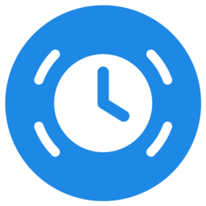
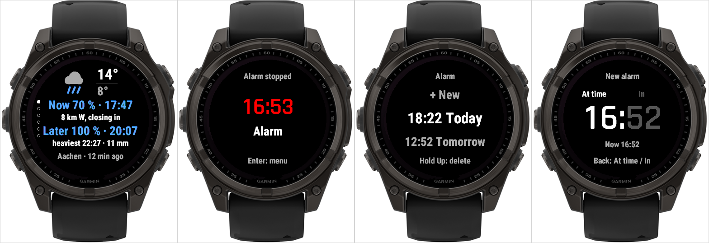

<table>
<tr>
<td width="100">

</td>
<td>
<h1>pai-garmin</h1>
A Garmin watch app for your PAI Cloud server: see whether it will rain, and set, change, delete and stop alarms from the wrist.
</td>
</tr>
</table>

[](https://github.com/frederikberg/pai-garmin/actions/workflows/ci.yml)
[](https://opensource.org/licenses/MIT)

Open it and a small menu shows, with Computer as its first entry: one Start and, on watches with audio, Computer is a spoken call with the server. A buzz says when to speak, Start sends what you said, the answer plays with its sentence on screen, Start during the answer cuts it off, every press is confirmed by a buzz, and Back hangs up and returns to the menu. If an alarm rings, opening the app stops it. Below Computer the weather shows a symbol with the highest and lowest temperature for the next twelve hours above the chance of rain now and later, in two rows, and Down pages on to the rain bars, the temperature, the UV index, four days and the radar picture; the alarms are one entry further down: pick an hour and a minute, press Start, done, or switch to a time from now in hours, minutes and seconds. The last entry, *Self-report*, takes a face (or none) and a spoken note and sends them to the server. What you set on the watch shows up on your phone and in the web app, and the other way round.

<p align="center">
  
</p>

## Why

- **Opening it stops the alarm.** An alarm that is ringing is stopped the moment the app opens, with no press, so the phone stops pushing too; the screen says it was stopped.
- **Built for buttons.** Every step works with the physical buttons alone; the time entry is hours, then minutes (then seconds for a time from now), then save.
- **Your server, not a cloud account.** The app talks only to the PAI Cloud server you enter in its settings.

## How it fits together

```
watch app  →  phone (Garmin Connect)  →  your PAI Cloud server
```

The watch sends HTTPS requests through the phone's Garmin Connect app, authenticated with a watch key you create on the server. The routes it uses are in [docs/api.md](docs/api.md). The alarm times are computed on the watch from its clock and sent as UTC.

## What you need

- A supported Garmin watch: the products listed in [manifest.xml](manifest.xml) (fēnix 8 family, epix 2 Pro 47 mm, Forerunner 265 and 965).
- A PAI Cloud server that offers the watch routes, and a watch key from its Watch keys page.
- The Garmin Connect app on the phone, paired with the watch.

## Install

Install the app through the Connect IQ app on the phone, then enter the *Server URL* and *Watch key* in its settings in Garmin Connect ([docs/usage.md](docs/usage.md) has the details).

To build it yourself you need the [Connect IQ SDK](https://developer.garmin.com/connect-iq/sdk/) with the device files and a developer key. A build copied over USB has no settings page in Garmin Connect, so `local.jungle` bakes the URL and key into the app as its default settings:

```sh
PAI_URL=https://pai.example.com PAI_WATCH_KEY=<key> ./configure
monkeyc -f local.jungle -d fenix8solar47mm -o bin/pai-garmin.prg -y developer_key.der -w
```

`configure` writes `config/properties.xml`, which is not tracked; the key is readable inside the `.prg`, so treat the file like the key. Copy the `.prg` to `GARMIN/Apps` on the watch over USB. `monkey.jungle` builds the same app with empty settings, which is what a store package needs.

## Develop

- Unit tests: `monkeyc -f monkey.jungle -d fenix8solar47mm -o bin/test.prg -y developer_key.der -t`, then `monkeydo bin/test.prg fenix8solar47mm -t` with the simulator running. They cover the alarm time arithmetic, response parsing, the weather wording and pages, the forecast block and the settings.
- `tools/stub-server.ts` ([Bun](https://bun.sh)) stands in for the server: `WATCH_KEY=<key> SCENARIO=alarms bun tools/stub-server.ts`. Scenarios: `alarms`, `empty`, `ringing`, `rejected`, switchable while running with `GET /__stub/scenario?name=<scenario>`; `ALARM_DELAY_MS` (or `GET /__stub/delay?ms=<ms>`) delays the alarm answer to imitate a slow link; the weather answer has its own (`WEATHER=<name>`, `GET /__stub/weather?name=<name>`) and so does its forecast block (`CONDITIONS=<name>`, `GET /__stub/conditions?name=<name>`); names in the stub's header. Point `./configure` at it (from the simulator the host is usually `172.17.0.1`, and a plain `http://` address needs *Settings > Use Device HTTPS Requirements* off).
- A build with a glance view starts the simulator in glance mode. `preview.jungle` is a local build without the glance, so the simulator opens the app itself.
- CI (`.github/workflows/ci.yml`) compiles with a throwaway key and runs the tests for every product in the manifest.

## Docs

- [docs/usage.md](docs/usage.md): setup, controls, what the screens show
- [docs/api.md](docs/api.md): the server routes the app calls

## Known limitations

- Weather has no glance and no background refresh: it asks the server when you open it and when you press Start.
- Alarms ring once. There is no repeat, no name and no snooze on the watch.
- The watch never rings or vibrates by itself: the server sends the alarm to your phone, and the watch only shows and stops it.
- Times are shown on a 24 hour clock.

## Not affiliated

Garmin and Connect IQ are trademarks of Garmin Ltd. or its subsidiaries. This project is not affiliated with, endorsed or sponsored by Garmin.

## License

[MIT](LICENSE)
