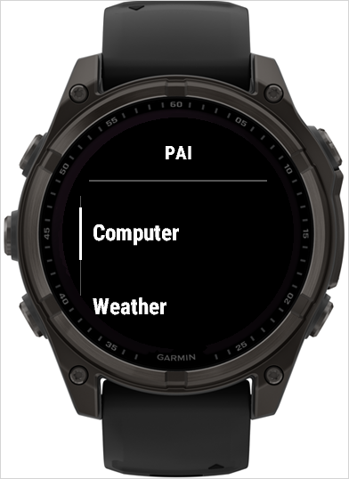
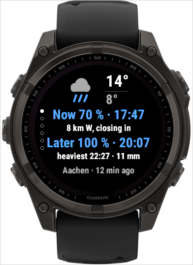
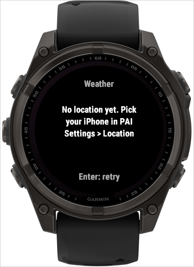

# Using the watch app

## Setup

The app needs the address of your server and a watch key. In Garmin Connect on the phone, open the watch's Connect IQ apps, choose PAI and fill in *Server URL* and *Watch key*. Until both are set the watch says so and sends nothing; a change arrives while the app runs and takes effect at once.

The key travels through Garmin's app settings, so revoke it on the server if you stop using the app.

## Opening it

From the glance list: the glance shows the next alarm (or that one rings), and Start opens the app. From the app list the app works the same way.

The menu comes first and appears at once, without waiting for the network: *Computer* (selected, only on watches with audio), *Weather* and *Alarm*. Start opens the screen you chose, and only then does anything go to the server.

Right after the app opens it also checks, in the background, whether an alarm rings. The check goes out first, so a screen opened in the meantime shows "Loading..." for a moment and its request follows once the check is over. If nothing rings, the check is invisible. If an alarm rings, the app stops every ringing alarm by itself, drops whatever you had just opened and shows the alarm's time and name with "Stopping..." and then "Alarm stopped"; Start returns to the menu. If stopping fails, the screen says why and Start tries again. The glance only shows that an alarm rings; it never stops it.

Back leaves a screen; Back on the first one exits the app.

  
  

## Computer

Talking to the server from the wrist, on watches with audio. Opening *Computer* starts a call at once. The server's ready tone plays, and then the watch records your turn by itself, without waiting for anything else: a red ring around the screen and the time say the microphone is open. Start sends the turn and buzzes briefly, since the server answers a moment later; the screen says *Sending* until the server has it. Taps on the screen do nothing. While the answer is generated the screen says *Thinking* and shows what the server heard; while it speaks it says *Speaking*. When the answer has finished playing the watch records the next turn. Start during the answer cuts it off at once and records again. Up and Down change the volume, Back hangs up. Holding Up opens a menu with *New call*, which drops the current call and starts a fresh one.

The line near the bottom shows the volume and the state of the link. When requests fail the watch repeats them with growing waits, keeps what you said (up to about half a minute of speech) while the link is down, carries on with the same call when it returns and opens a new call when the server no longer knows the old one; the line then names what is being repeated and how often. Everything that goes wrong, with the codes Connect IQ reports, is sent to the server's log for the call. If the server ends the call, the screen says why and Start opens a new one. A key that is not the owner's is told that Computer is only for the owner. When recording fails several times in a row (the microphone, or audio the server refuses) it stops and says why until Start tries again; a server that keeps losing the call does the same.

Opening the app from the glance list and pressing Up or Down now and then keeps it open.

## Weather

Start on *Weather* asks the server once and shows two rows:

- **Now** is the chance of rain in the next hour, from the rain radar. When rain is on its way the time it reaches you follows, with a line below such as "8 km W, closing in"; "raining now, until 15:40" while it rains; "dry around you" when nothing is near. Where no radar covers the place the line says "forecast only".
- **Later** is the chance over the next twelve hours and, if rain is likely, when it starts, with a line naming the hour it rains hardest and how much falls in all ("heaviest 21:00 · 11 mm").

The colour follows the server's verdict: blue for rain, yellow for maybe, green for unlikely or dry, grey when there is no answer. The line under the rows names the place and how long ago the phone reported it. Start asks again, Back returns to the menu.

Down turns to the next twelve hours as bars: each bar is as tall as the hour's chance and as dark a blue as the rain is heavy, with every third hour named below. Down again shows the rain radar half an hour ahead around you, the dot in the middle being you; Up pages back. The dots on the left edge show which page is open.

  
  
  

Without a location the screen says to pick your iPhone in PAI Settings, Location. If the weather source is down it says to try again, and a rejected key, a missing phone connection or a server error are worded like on the other screens.

## Alarms

The Alarm screen lists *+ New* first, then the armed alarms, soonest first, each with its time and day.

| Where | Button | Does |
|---|---|---|
| Computer | Start | send the turn being recorded; during the answer, cut it and record again |
| Computer | Up / Down | volume up / down |
| Computer | hold Up | menu with New call |
| Computer | Back | hang up |
| list | Down / Up | move through the list |
| list, on *+ New* | Start | create an alarm |
| list, on an alarm | Start | change its time |
| list, on an alarm | hold Up | open its menu, whose only entry deletes it |
| time entry | Up / Down | add / subtract one to the marked number, wrapping; held, it repeats and speeds up |
| time entry | Start | from hours to minutes, then save |
| time entry | Back | from minutes to hours, then cancel |

An alarm has no name and rings once, at the next time the clock shows the chosen hour and minute. The time entry starts at the current time for a new alarm and at the alarm's own time for a change, and shows the current time underneath while you pick. Setting a new alarm to the minute it is now means tomorrow. After saving, the list is read from the server again and the saved alarm is selected, so the list always shows what the server holds, including alarms made on other devices.

  
  

## When something is wrong

The screen names the problem and Start tries again: no phone connection, server URL or key not set, key rejected, no answer within 25 seconds, or the server's HTTP status.
