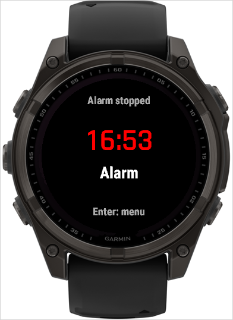
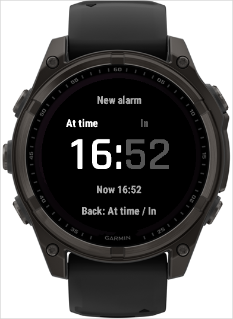

# Using the watch app

## Setup

The app needs the address of your server and a watch key. In Garmin Connect on the phone, open the watch's Connect IQ apps, choose PAI and fill in *Server URL* and *Watch key*. Until both are set the watch says so and sends nothing; a change arrives while the app runs and takes effect at once.

The key travels through Garmin's app settings, so revoke it on the server if you stop using the app.

## Opening it

From the glance list: the glance shows the next alarm (or that one rings), and Start opens the app. From the app list the app works the same way.

When the app opens it asks the server what is going on:

- **An alarm is ringing:** the screen shows its time and name. Start stops every ringing alarm and goes on to the menu.
- **Otherwise** the menu: *Weather* (first, selected) and *Alarm*. Weather is a placeholder that says "Coming soon".

Back leaves a screen; Back on the first one exits the app.

  
  

## Alarms

The Alarm screen lists *+ New* first, then the armed alarms, soonest first, each with its time and day.

| Where | Button | Does |
|---|---|---|
| list | Down / Up | move through the list |
| list, on *+ New* | Start | create an alarm |
| list, on an alarm | Start | change its time |
| list, on an alarm | hold Up | open its menu, whose only entry deletes it |
| time entry | Up / Down | add / subtract one to the marked number, wrapping; held, it repeats and speeds up |
| time entry | Start | from hours to minutes, then save |
| time entry | Back | from minutes to hours, then cancel |

An alarm has no name and rings once, at the next time the clock shows the chosen hour and minute. The time entry starts at the next full hour for a new alarm and at the alarm's own time for a change. After saving, the list is read from the server again and the saved alarm is selected, so the list always shows what the server holds, including alarms made on other devices.

  
  

## When something is wrong

The screen names the problem and Start tries again: no phone connection, server URL or key not set, key rejected, no answer within 25 seconds, or the server's HTTP status.
