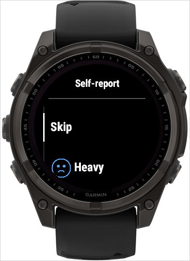
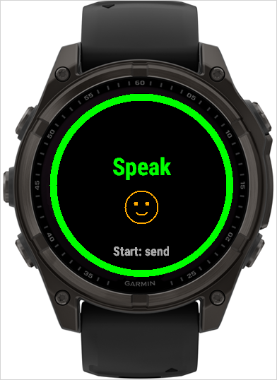
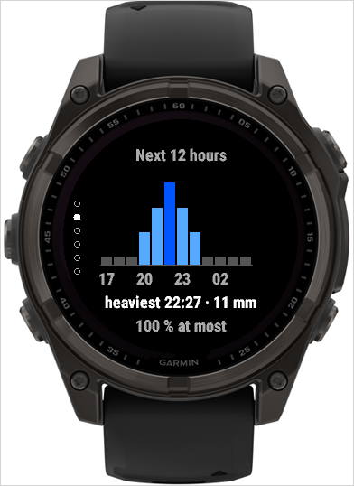
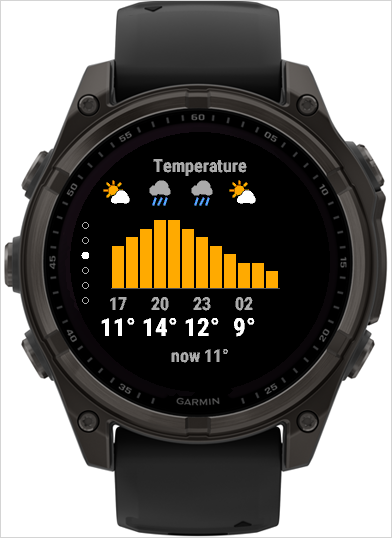
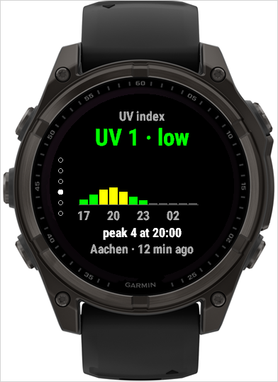
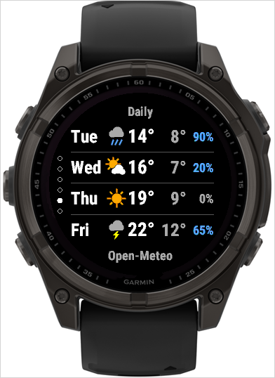
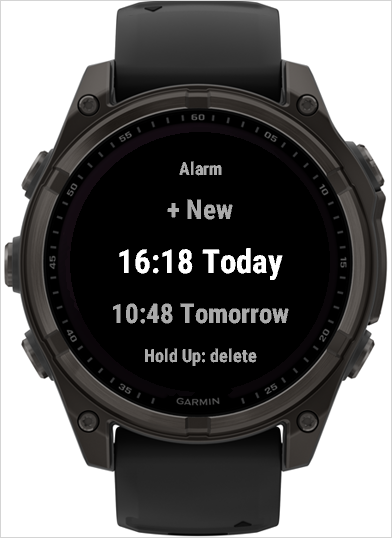
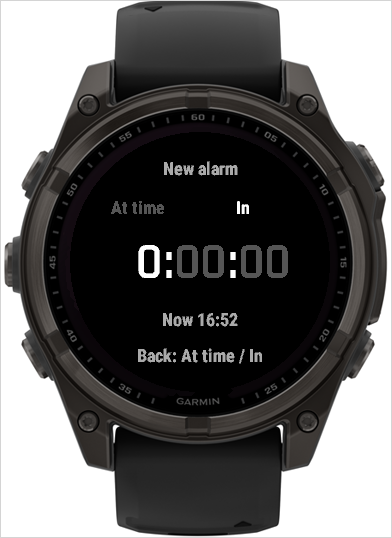

# Using the watch app

## Setup

The app needs the address of your server and a watch key. In Garmin Connect on the phone, open the watch's Connect IQ apps, choose PAI and fill in *Server URL* and *Watch key*. Until both are set the watch says so and sends nothing; a change arrives while the app runs and takes effect at once.

The key travels through Garmin's app settings, so revoke it on the server if you stop using the app.

## Opening it

However you open the app (the app list, a hot key set to the app, or the glance list, where the glance shows the next alarm, or that one rings, and Start opens the app) the menu comes first. It appears at once, without waiting for the network: *Computer* (selected, only on watches with audio), *Weather*, *Alarm* and, on watches with audio, *Self-report*. Start opens the screen you chose, and only then does anything go to the server, so from a hot key one more Start begins a call.

Right after the app opens it also checks, in the background, whether an alarm rings. The check goes out first, so a screen opened in the meantime shows "Loading..." for a moment and its request follows once the check is over. If nothing rings, the check is invisible. If an alarm rings, the app stops every ringing alarm by itself, drops whatever you had just opened and shows the alarm's time and name with "Stopping..." and then "Alarm stopped"; Start returns to the menu. If stopping fails, the screen says why and Start tries again. The glance only shows that an alarm rings; it never stops it.

Back leaves a screen; Back on the menu exits the app.

  
  

## Computer

Talking to the server from the wrist, on watches with audio. Start on *Computer* begins a call, and the watch listens at once, without waiting for the call to be up. The screen is one word in a ring of the state's colour: a grey *Wait* while the microphone starts, then one short buzz says *speak now* and a green *Speak* shows: the microphone is recording. Start sends the turn: two short buzzes say it was taken; a yellow *Sending* shows until the server has it. Taps on the screen do nothing. While the answer is generated the screen says *Thinking* (yellow) and shows what the server heard; while it plays it says *Speaking* (blue) and shows the sentence being spoken. Red means something stopped, with the reason underneath. When the answer has finished playing the watch starts the microphone again, and the same short buzz says when you can speak. Start during the answer cuts it off at once and records again. Up and Down change the volume, which shows for a moment and is kept for the next time. Holding Up opens a menu with *New call*, which drops the current call and starts a fresh one.

Back hangs up: two short buzzes and a longer one say the call is over, and the menu shows again once the server has heard it, two seconds at most. The server ends the call the same way when you have said nothing for three minutes in your turn, so a call left running by mistake does not run for ever; Computer can also end a call. Either way the bye buzz comes once what was playing has finished, and the menu shows again.

Every press the call takes buzzes, so you know without looking that it worked: the two short buzzes for a send, and a single very short tap for anything else (cutting an answer, beginning a turn, going back to Computer from a session), followed by the *speak* buzz once the microphone listens. A long buzz with a sound means the call stopped for a reason, which is on the screen. The patterns are listed in [api.md](api.md#signals).

When requests fail the watch repeats them with growing waits, keeps what you said (up to about half a minute of speech) while the link is down, carries on with the same call when it returns and opens a new call when the server no longer knows the old one; an orange line near the bottom then names what is being repeated and how often. Everything that goes wrong, with the codes Connect IQ reports, is sent to the server's log for the call. A key that is not the owner's is told that Computer is only for the owner. When recording fails several times in a row (the microphone, or audio the server refuses) it stops and says why until Start tries again; a server that keeps losing the call does the same.

Computer can connect the call to one of your sessions when you ask it to, ready for you to speak or to listen. The screen then shows only the state and the session's name, in the middle where the round display has room for it: *Speak* (green) while you record, *Listening* while the session may answer, *Speaking* (blue) while it does. Neither what you say nor what the session says shows. Start sends what you said, cuts what plays, or begins a turn while the screen says *Listening*; after the session has spoken the watch never records by itself, so you can stay listening as long as you like (a server may still cap a whole call; PAI Cloud ends any call after four hours). When the session has finished speaking, one short buzz says that Start is your move. Back returns to Computer instead of hanging up; if you were speaking, what was heard goes into the session's draft, unsent, as it does when the call ends any other way. Once you are back with Computer, Back hangs up as usual.

The app settings in Garmin Connect also have a *Mic filter* switch (noise and echo reduction on the microphone, off by default). The app settings in Garmin Connect have a *Debug log* switch. With it on, the trace of a Computer call is detailed (a line for every request and every piece), which shows where time goes; either way a turn leaves one summary line with its timings besides the errors.

Opening the app from the glance list and pressing Up or Down now and then keeps it open.

## Self-report

A spoken diary entry, on watches with audio. Start on *Self-report* shows *Skip* (selected) and three faces: *Heavy* (blue, frowning), *Okay* (grey, flat) and *Good* (amber, smiling). Pick one, or Skip to send only your words; Start on it opens the microphone at once, the same way Computer does. A grey *Wait* turns into a green *Speak* with one short buzz when the microphone delivers; the chosen face shows below it. Start ends the recording and sends it in one request (a recording ends by itself at 64 KiB, about half a minute of speech). While it goes the screen says *Sending* and Back is ignored; when the server has it, two short buzzes sound and *Saved* shows for three seconds before the sub-app list returns, or at once on Back.

If the server does not take the recording, a long buzz sounds and the screen says *Not sent* with the reason; Start sends the same recording again (the server knows it by its id, so a repeat is not a second entry) and Back drops it. Back before sending drops the recording too. Nothing plays and nothing is answered: the server turns the audio into a diary entry afterwards.

  
  
  

## Weather

Start on *Weather* asks the server once. The first screen shows a symbol for the next twelve hours (a moon when most of them are dark) with the highest temperature over the lowest beside it, and under that two rows:

- **Now** is the chance of rain in the next hour, from the rain radar. When rain is on its way the time it reaches you follows, with a line below such as "8 km W, closing in"; "raining now, until 15:40" while it rains; "dry around you" when nothing is near. Where no radar covers the place the line says "forecast only".
- **Later** is the chance over the next twelve hours and, if rain is likely, when it starts, with a line naming the hour it rains hardest and how much falls in all ("heaviest 21:00 · 11 mm").

The colour follows the server's verdict: blue for rain, yellow for maybe, green for unlikely or dry, grey when there is no answer. The line under the rows names the place and how long ago the phone reported it. Start asks again, Back returns to the menu.

Down walks the pages, Up walks back, and both wrap, so the radar picture is one Up from the first screen. The dots on the left edge show which page is open.

- **Rain**: the next twelve hours as bars, each as tall as the hour's chance and as dark a blue as the rain is heavy, with every third hour named below.
- **Temperature**: the same twelve hours as bars (orange, ice blue at or below 0 °C), with the symbol, hour and temperature of every third hour and the temperature now at the bottom.
- **UV index**: the index valid now at the top, in the colour of its band (none, low, moderate, high, very high, extreme), then twelve bars on one fixed scale, so a bar means the same in July and in November, and the peak with its hour. At night it reads *UV 0 · none*.
- **Daily**: today and the next three days as in the watch's own daily glance: weekday, symbol, highest, lowest and the chance of rain, credited to Open-Meteo.
- **Radar**: the rain radar half an hour ahead around you, the dot in the middle being you.

A page the answer cannot fill does not exist. If the forecast is down, the first screen says *no forecast* and only the rain pages are left; if the rain is down, its row says *no answer* and the forecast pages stay. While Start asks again the last line of the page reads *Updating...*; if that fails the answer stays for up to 30 minutes with *not updated* and the time it arrived in orange, and after that the screen says what failed.

  
  
  
  
  
  

Without a location the screen says to pick your iPhone in PAI Settings, Location. If the weather source is down it says to try again, and a rejected key, a missing phone connection or a server error are worded like on the other screens.

## Alarms

The Alarm screen lists *+ New* first, then the armed alarms, soonest first, each with its time and day.

| Where | Button | Does |
|---|---|---|
| Computer | Start | send the turn being recorded; during the answer, cut it and record again; begin a turn when the screen says *Ready* or *Listening* |
| Computer | Up / Down | volume up / down |
| Computer | hold Up | menu with New call |
| Computer | Back | hang up and return to the menu; in a session's call, back to Computer |
| list | Down / Up | move through the list |
| list, on *+ New* | Start | create an alarm |
| list, on an alarm | Start | change its time |
| list, on an alarm | hold Up | open its menu, whose only entry deletes it |
| time entry | Up / Down | add / subtract one to the marked number, wrapping; held, it repeats and speeds up |
| time entry | Start | to the next number, then save |
| time entry | Back | to the previous number; from the first number of a new alarm to the choice *At time* / *In*, then cancel |
| time entry, on the choice | Up / Down | switch between *At time* and *In* |

An alarm has no name and rings once. A new alarm is set *At time* (the default): hour and minute, ringing at the next time the clock shows them, starting at the current time with the current time shown underneath; setting it to the minute it is now means tomorrow. Back from the hours moves to the choice *At time* / *In*; *In* sets a duration from now as hours, minutes and seconds, starting at 0:00:00 (hours 0 to 23), shows when it will ring, and saves now plus that duration; a duration of zero is refused. A change is always a clock time and starts at the alarm's own time. An alarm whose time has seconds, which only a duration produces, is listed with them. After saving, the list is read from the server again and the saved alarm is selected, so the list always shows what the server holds, including alarms made on other devices.

  
  
  

## When something is wrong

The screen names the problem and Start tries again: no phone connection, server URL or key not set, key rejected, no answer within 25 seconds, or the server's HTTP status.
